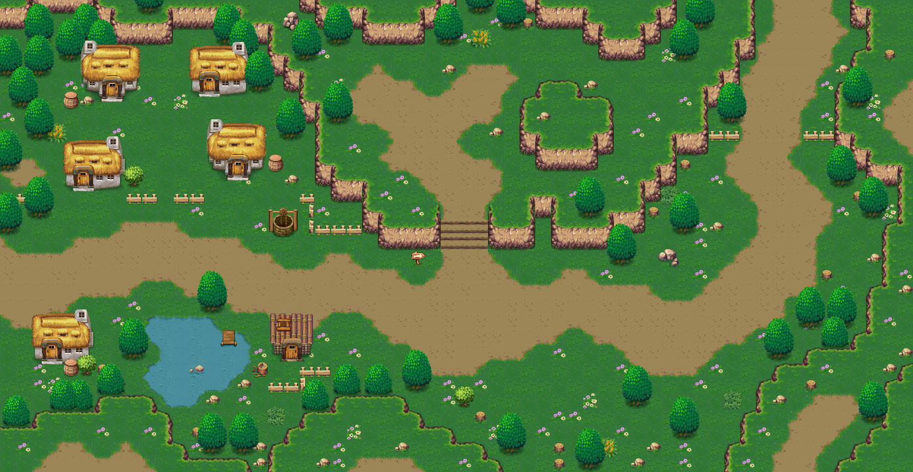

# Khả năng thêm menu Map

Trạng thái: viewer Map `/maps` đã triển khai. Dữ liệu tĩnh gồm91 layout,14 tileset và307 template vật thể đã đóng gói trong public/game/maps. Xem [cách dùng và giới hạn](maps.md). Chưa có editor chỉnh tile/ghi server.

## Dữ liệu đã kiểm tra

- SQLite có91 bản ghi maps và124 tên trong map_data. Có đủ91 file mapnew tương ứng91 map đang cấu hình;33 tên còn lại chưa có layout trong bộ dữ liệu hiện tại.
- Giải mã được header/name, payload lưới và danh sách vật thể của cả91 file theo ReadMessenge.changeMap/LoadMap.loadmap/load_ItemMap trong Java4.0.3. Mỗi payload lưới có đúng3+width×height byte, ô24×24 logical units.
- Có14 tileset ID được sử dụng. Tất cả có PNG nền x4 trong catalog/public/game; mọi chỉ số tile nền nằm trong PNG. Ảnh nước/minimap riêng vẫn cần kiểm tra theo từng loại, không coi PNG placeholder1×1 là tileset đầy đủ.
- Bảng vật thể server gửi trong msg_1 có307 template; **khác** resource table_item mặc định trong JAR. Dùng bảng msg_1 như client Login_Ok ghi đè, không dùng bảng JAR thay thế.
- Tất cả template vật thể được91 layout tham chiếu đều tìm được trong bảng server và có PNG x4 tương ứng trong Studio. Tồn tại ảnh không đồng nghĩa đã khôi phục đầy đủ mọi hiệu ứng.
- maps chứa mob spawn, danh sách NPC và cổng chuyển map. NPC là tham chiếu packet riêng; cần đọc vị trí từ packet tương ứng trước khi vẽ marker/actor, không đoán theo tên.

## Bằng chứng dựng thử

Map0 Ngôi Làng Nhỏ:58×30 ô =1392×720 logical units,77 vật thể tĩnh. Ảnh dưới dựng bằng PNG gốc, tọa độ và offset theo table server, nền ở một thời điểm tĩnh. Chưa có nhân vật/NPC/quái, chu kỳ hiệu ứng, parallax và logic gameplay. Đây là ảnh kiểm tra bố cục, không phải màn chơi hoàn chỉnh hoặc cam kết mọi map đã render đầy đủ.

## Menu đã triển khai

Route `/maps`, menu “Map” cùng cấp Character Lab và Thư viện dữ liệu.

Bản viewer hiện tại:

1. Chọn/tìm map theo tên/ID, hiện kích thước và tileset, chỉ mở layout thật có sẵn.
2. Canvas pan/zoom, fit-to-view, lưới24×24, xem tọa độ ô/world khi trỏ chuột.
3. Bật/tắt nền, vật thể, collision nền/vật thể và cổng chuyển map; mob spawn là marker từ dữ liệu nguồn. NPC chỉ bật khi giải mã đúng packet.
4. Inspector map và vật thể: ID template/ảnh, offset, ô chặn và source; báo nhóm chưa hỗ trợ.
5. Xuất PNG kiểm tra, JSON layout/tileset/object/collision và ZIP cho Phaser. Giai đoạn đầu là viewer để kiểm chứng renderer; chỉnh tile/đặt vật thể/nháp là bước kế tiếp sau khi dữ liệu được xác nhận.

## Các phần cần đối chiếu tiếp

- Chu kỳ nước và waterfall (tile mới ID>=9 có nhánh riêng), background/parallax và lớp hiệu ứng ở đuôi object payload.
- Collision không chỉ là tile: template.Block, NPC và trạng thái runtime cũng có thể chặn. Không đồng nhất mapType0/1/2 với mọi quy tắc di chuyển/chiến đấu của server.
- Thứ tự vật thể với actor theo y, NPC/mob sprites và animation, spawn/event/zone thay đổi khi chạy game.
- JSON của Phaser phải ghi rõ các lớp hỗ trợ/chưa hỗ trợ, giữ logical24×24 dù dùng PNG x4. Chưa khẳng định là gói Tiled tương thích trực tiếp.

## Đóng gói và phụ thuộc

Ảnh x4 có trong public/game; layout và bảng msg_1 đã được đóng gói thành JSON kèm rawHex/checksum trong public/game/maps. Dev/build/runtime chỉ đọc dữ liệu tĩnh này, không cần thư mục hso, JAR, Java hoặc Python. Không thêm project scripts làm điều kiện chạy.

Nguồn đối chiếu: server Map.send_map_data, data/mapnew, msg_1; Java4.0.3 ReadMessenge.Login_Ok/changeMap, LoadMap.loadmap/load_ItemMap/paint/Block_TileMap_Item, ItemMap.paint, ObjectData.getImagePartItemMap và CRes.quickSort1.
