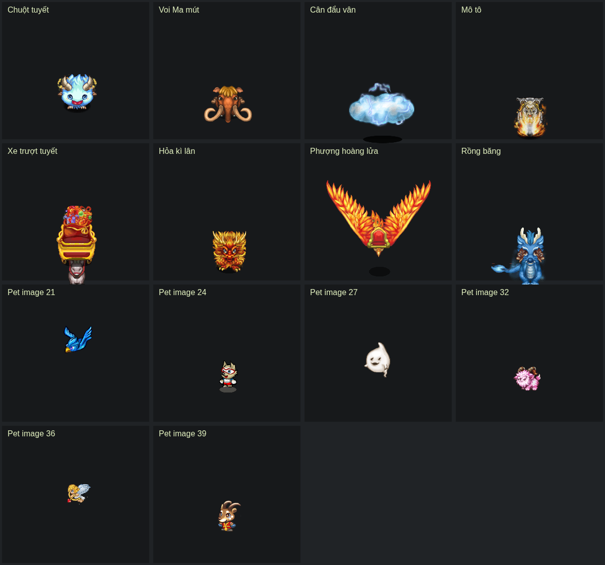

> Đây là báo cáo kiểm tra trước triển khai. Phần dữ liệu đã xác minh hiện được tích hợp cho đứng/đi; xem [trạng thái và phạm vi hiện tại](composite-companions.md). Ba item271/272/283 vẫn chưa đủ mapping.

# Kiểm tra khả năng dựng các vật phẩm chưa hỗ trợ

## Kết luận

Trong 34 mục đang báo chưa hỗ trợ, **31 mục xác định được nguồn ngoại hình và dữ liệu dựng chính**. Ba mục còn thiếu mapping xác minh: item4 #271 Trâu rừng, #272 Trâu rừng x99, #283 Mô tô ma tốc độ.

Đã chạy parser thử ngoài project và dùng Chrome dựng frame gốc từ dữ liệu; ảnh bên dưới là bằng chứng dựng tĩnh, không phải renderer đã tích hợp vào Studio. Không thêm scripts hoặc phụ thuộc mới cho dev/build/runtime. Chưa thay trạng thái ready trong catalog: chỉ có dữ liệu chưa đủ để khẳng định đã preview/equip/export hoàn chỉnh.

Các thẻ là bố trí kiểm tra. Chưa ghép người cưỡi, chưa phát toàn bộ chu kỳ/hướng trong ảnh này. PNG không được vẽ lại; crop, offset, flip và thứ tự lớp lấy từ metadata.

## 1. Các gói x99: không cần dựng thêm ngoại hình

Đối chiếu `hso/src/main/java/client/UseItem.java`, `use_item_mount`: các case dưới tạo item4 `itbag.id = id - 1`, quantity99.

| Gói | Đổi sang | Ngoại hình |
|---|---|---|
| 125 | 124 | Tuần lộc, đã có rig sheet type5 |
| 223 | 222 | Heo rừng, đã có rig sheet type11 |
| 247 | 246 | Con lân, đã có rig sheet type12 |
| 270 | 269 | Voi Ma mút, effect106 |
| 276 | 275 | Cân đẩu vân, effect111 |
| 280 | 279 | Mô tô, effect114 |
| 282 | 281 | Xe trượt tuyết, effect115 |
| 295 | 294 | Hỏa kì lân, effect116 |
| 300 | 299 | Phượng hoàng lửa, effect117 |
| 302 | 301 | Rồng băng, effect121 |

Ba mục đầu có thể ánh xạ vào rig hiện có. Bảy gói còn lại dùng chung ngoại hình với nhóm effect bên dưới; không tạo bản sao art theo tên vật phẩm.

## 2. Thú cưỡi hiệu ứng: có PNG và rig chính

Chuỗi xác minh: `UseItem.use_item_mount` đặt `type_use_mount` và `id_horse`; client `MainObject.getEffMatNa(idHorse)` request **type113**, `ReadMessenge.loadImageDataCharPart` chuyển metadata cho `DataSkillEff.loadData`. Đã xác nhận đúng họ113, không suy từ tiền tố trùng id_horse.

| Ngoại hình | Vật phẩm trực tiếp | typeMount | id_horse / packet113 | Số frame / nhóm21 |
|---|---|---:|---:|---:|
| Chuột tuyết | 251,268 | 17 | 69 | 63 /3 |
| Voi Ma mút | 269,296 | 15 | 106 | 84 /4 |
| Cân đẩu vân | 275 | 17 | 111 | 63 /3 |
| Mô tô ma tốc độ | 279,316 | 20 | 114 | 63 /3 |
| Xe trượt tuyết | 281,317 | 20 | 115 | 63 /3 |
| Hỏa kì lân | 294,315 | 20 | 116 | 63 /3 |
| Phượng hoàng lửa | 299,313 | 22 | 117 | 126 /6 |
| Rồng băng | 301,314 | 20 | 121 | 126 /6 |

Tổng nhóm này là 15 item trực tiếp +7 gói =22 mục trong danh sách chưa hỗ trợ, tương ứng8 ngoại hình.

Đã giải mã prefix metadata của cả tám packet x1 và x4 theo `DataSkillEff.loadData`: bảng SmallImage, các PartFrame dx/dy/id/flip/onTop, sequence và frameChar. Tất cả tham chiếu PartFrame hợp lệ và các crop nằm trong PNG logical theo density ở cả hai độ phân giải. Frame chia hết cho21. Metadata có byte đuôi ngoài phần client4.0.3 đọc; khi nhập chính thức phải giữ lại raw/provenance, không tự gán nghĩa.

Renderer cần port thêm:

- `MainObject.getFrameHorse`: hướng down offset0, up7, side14; cộng frameThuCuoi×21.
- `frameThuCuoi` tiến mỗi5 game tick; số phase là listFrame.size/21.
- `Fhorse`: đứng, di chuyển theo horseMove; khi đánh, client đặt frame+1.
- `DataSkillEff.paintBottomHorse/paintTopHorse`: lớp dưới/trên người, flip và offset từng mảnh.
- Các bảng MountTemplate của type15/17/20/22 và logic người cưỡi trong MainObject; không tái sử dụng rig ngựa sheet bằng cách đổi ID.

Có đủ cơ sở dữ liệu để khôi phục renderer chính, nhưng ảnh dựng tĩnh chưa chứng minh điểm ngồi, chuyển trạng thái, hiệu ứng phụ và ZIP đã đúng. Cần kiểm thử các phần đó khi triển khai.

## 3. PetTool: metadata nằm trong msg_26

`ReadMessenge.catalogyMonster` đọc block Pet.PET_DATA từ `hso/data/msg/msg_26`. Mỗi block theo imageId chứa payload `DataEffect.setDataType1`. `PetTool.paint` lấy ảnh qua ObjectData.getImagePet(imageId), tức icon ID10200+imageId, rồi dựng từng mảnh bằng DataEffect.paintPet.

Đã đọc bảng crop, PartFrame và8 timeline tương ứng hai nhóm hướng ×4 trạng thái; kiểm tra PNG x4 đã đóng gói.

| Pet | Item3 | imageId | Frame | Kết quả |
|---|---:|---:|---:|---|
| Phượng hoàng băng | 4626 | 21 | 7 | Đứng/đi hợp lệ; một tham chiếu lỗi trong đòn đánh |
| Zabivaka | 4631 | 24 | 11 | Crop, PartFrame và timeline hợp lệ |
| Bóng ma | 4699 | 27 | 8 | Crop, PartFrame và timeline hợp lệ |
| Yêu tinh | 4761 | 32 | 7 | Crop, PartFrame và timeline hợp lệ |
| Thiên thần | 4762 | 36 | 15 | Crop, PartFrame và timeline hợp lệ |
| Sao la | 4768 | 39 | 11 | Crop, PartFrame và timeline hợp lệ |

Phượng hoàng băng: animation index2, tick index8 trỏ frame64, trong khi listFrame chỉ có index0–6. `Animation` giữ byte frame nguyên dạng; chưa thấy quy tắc giải mã64 thành frame khác. Theo indexAction2, đây là timeline đánh ở nhóm hướng0. Không tự sửa thành frame0 hoặc đoán hình thay. Có thể dựng idle/move trước, còn attack cần xử lý phù hợp client hoặc tìm bản metadata đúng.

Đã dựng thử frame đầu của cả6 pet. Cần port PetTool.setHuong, mAction, frame counter, độ cao isFly, bóng và state machine trước khi gọi là hỗ trợ hoàn chỉnh. AI đi theo/chiến đấu là phạm vi riêng.

## 4. Ba mục chưa đủ mapping

- **Trâu rừng #271 /x99 #272:** chưa thấy case trong use_item_mount của server hiện tại; ảnh candidate icon/x4/10714.png chỉ16×16 pixel, không đủ chứng minh đây là sprite trâu. Không gán type14 chỉ dựa vào thứ tự ID hoặc tên.
- **Mô tô #283:** cùng tên với item279 nhưng chưa thấy handler xác lập cùng ngoại hình. Không dùng tên trùng làm bằng chứng mapping.

Chưa kết luận các mục này không thể dựng; cần thêm mapping/client phiên bản phù hợp hoặc packet thực tế.

## Bản nguồn đã đối chiếu

JAR4.0.3 SHA256: `f023b34e0ba0a3dcf44249ed5f90b78f0427deee4668562b8e3a0e9e349b18c6`.

Các phương thức chính: MainObject.getEffMatNa/getFrameHorse/updateMount/paintPlayer; DataSkillEff.loadData/paintBottomHorse/paintTopHorse; PetTool.paint/doChangeFrmaeBoss/setHuong; DataEffect.setDataType1/getFrame/paintPet; ReadMessenge.catalogyMonster/loadImageDataCharPart; UseItem.use_item_mount.

Nếu triển khai, chỉ nhập PNG/metadata đã xác minh vào repo. Studio vẫn phải chạy độc lập với thư mục HSO, Java, Python và scripts; các nguồn trên chỉ phục vụ đối chiếu lần này.
